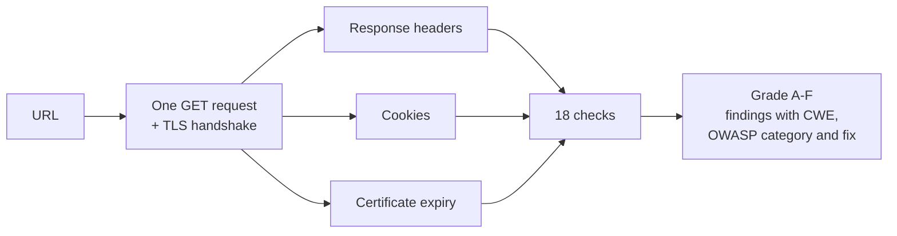

# web-header-auditor


A small Python tool that audits a website's security configuration from the outside. It reads
the HTTP response headers, cookies, CORS behaviour and TLS certificate, runs 18 checks, and
gives the site a grade from A to F with a fix for every finding. It automates the
"security misconfiguration" part of a web application assessment. Python 3.8+ standard library only.

It sends one ordinary GET request and one TLS handshake, the same as a browser opening the page. No attack traffic.

## How it works



1. **Fetch** – request the page, following redirects, and note the final URL.
2. **Check** – compare what the server sent against what a hardened server should send.
3. **Grade** – start at 100 and subtract 20 for each high, 10 for each medium and 5 for each low finding.

## Checks

| Area | What is checked | CWE | OWASP Top 10 (2021) |
|---|---|---|---|
| Transport | Plain HTTP, missing or short HSTS, certificate expiring within 30 days | CWE-319 | A02 Cryptographic Failures |
| Content Security Policy | Missing; `'unsafe-inline'`, `'unsafe-eval'` or `*` allowed for scripts | CWE-693 | A05 Security Misconfiguration |
| Clickjacking | No `X-Frame-Options` and no CSP `frame-ancestors` | CWE-1021 | A05 |
| Browser hardening | Missing `X-Content-Type-Options`, `Referrer-Policy`, `Permissions-Policy` | CWE-693, CWE-200 | A05 |
| Information disclosure | `Server`, `X-Powered-By`, `X-AspNet-Version` revealing software versions | CWE-200 | A05 |
| Cookies | Missing `Secure`, `HttpOnly`, `SameSite` | CWE-614, CWE-1004, CWE-1275 | A02, A05, A01 |
| CORS | Reflects any `Origin` (worse with credentials), or allows `*` | CWE-942 | A05 |

## Run it

```bash
python header_audit.py https://github.com --json report.json
```

To see a bad site and a good site side by side without touching anyone's server, run the demo. It starts two sites on your own machine and audits both:

```bash
python demo.py
```

```
=== CARELESS SITE ===
Grade F (0/100), 12 findings

[HIGH  ] CWE-319  A02  Page is served over plain HTTP
                     fix: Serve the site over HTTPS and redirect HTTP to it
[HIGH  ] CWE-942  A05  CORS reflects any Origin and allows credentials: other sites can read logged-in data
                     fix: Allow only a fixed list of trusted origins
[MEDIUM] CWE-693  A05  CSP allows 'unsafe-inline' for scripts, which defeats most of its XSS protection
                     fix: Remove 'unsafe-inline'; use nonces or hashes
[MEDIUM] CWE-1021 A05  Clickjacking: any site can load this page in a frame
                     fix: Add X-Frame-Options: DENY or CSP frame-ancestors 'none'
[MEDIUM] CWE-1004 A05  Cookie 'session' has no HttpOnly flag: scripts can read it
                     fix: Add HttpOnly
...

=== HARDENED SITE ===
Grade B (80/100), 1 findings

[HIGH  ] CWE-319  A02  Page is served over plain HTTP
```

The hardened demo site has every header right. Its one finding is plain HTTP, because a local demo server has no certificate.

## Tests

```bash
python -m unittest -v
```

13 tests cover every check and its clean counterpart, plus an end-to-end run against the two local demo sites. GitHub Actions runs them on every push.

## Design decisions worth knowing

- **The CORS check is active, but harmless.** A site that echoes back whatever `Origin` it receives cannot be spotted by reading a normal response, so the tool sends a made-up `Origin` and sees whether it comes back. With `Access-Control-Allow-Credentials: true` that means any website can read a logged-in user's data.
- **CSP is parsed, not string-matched.** `'unsafe-inline'` in `style-src` is common and low risk; in `script-src` it removes most XSS protection. The tool reads the directives and only flags the script rules. An early version flagged github.com for its style rule; this fixed it.
- **The checks are a pure function.** `assess()` takes a URL and a list of headers and touches no network, so every rule is unit-tested without a server.
- **Only web URLs are accepted.** `file://` and other schemes are rejected before any request is made.
- **An error page still gets audited.** A 403 or 404 response carries the same headers, so it is checked rather than treated as a failure.

## Limitations

- It sees one page. Headers can differ on other paths, and cookies set after login are not seen.
- A good grade means the configuration is sound, not that the application is free of vulnerabilities.
- It cannot judge whether a CSP's allowed origins are themselves trustworthy.
- Sites with an expired or untrusted certificate fail at the connection step and are reported as an error, not graded.
